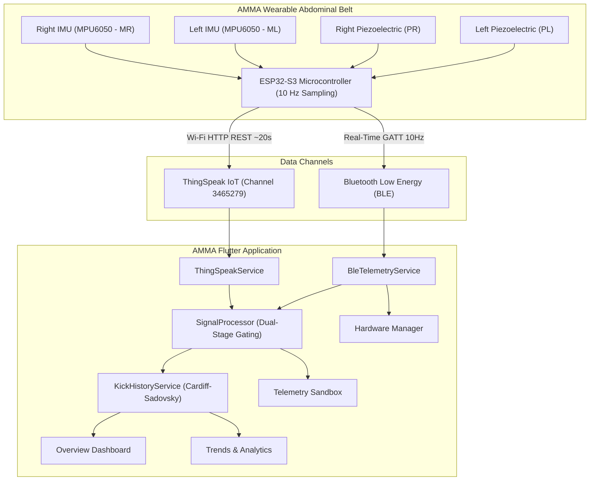

# AMMA — AI-Enabled Maternal Monitoring Assistant 🤰⚡

[](https://flutter.dev)
[](https://developer.android.com)
[](https://www.espressif.com)
[](https://thingspeak.mathworks.com)
[](test/)

> **A non-invasive, continuous fetal movement tracking and maternal telemetry suite.**  
> Designed to pair with a multi-sensor wearable abdominal belt powered by the **ESP32-S3**, AMMA captures objective fetal movement, cancels maternal motion artifacts, and provides expectant mothers and clinicians with date-accurate clinical insights.

---

## 📋 Table of Contents

- [Overview & Vision](#-overview--vision)
- [System Architecture](#-system-architecture)
- [Key Features](#-key-features)
- [Hardware & Sensor Mapping](#-hardware--sensor-mapping)
- [Signal Processing & Kick Algorithm](#-signal-processing--kick-algorithm)
- [App Navigation & Screens](#-app-navigation--screens)
- [Getting Started](#-getting-started)
- [Testing & Quality Assurance](#-testing--quality-assurance)
- [Project Structure](#-project-structure)
- [Clinical & Ethical Disclaimer](#-clinical--ethical-disclaimer)

---

## 🌟 Overview & Vision

During the third trimester (weeks 28–40), monitoring **fetal movement count (FMC)** is one of the most accessible indicators of fetal health. Traditionally, mothers perform subjective manual counting (e.g., the Cardiff "Count-to-Ten" method), which is prone to maternal distraction, sleep, anxiety, or misinterpretation of maternal body movement.

**AMMA** bridges this gap by combining:
1. An ergonomic, elastic abdominal belt equipped with **dual piezoelectric sensors** and **dual 6-axis IMUs** connected to an ESP32-S3 microcontroller.
2. A companion **Android application** written in Flutter that processes high-frequency telemetry in real time via **Bluetooth Low Energy (BLE)** and historical snapshots via **ThingSpeak IoT Cloud**.
3. **Cardiff-Sadovsky clinical protocols** to compute daily, weekly, and 30-day cumulative movement distributions with strict timestamp accuracy.

---

## 🏗️ System Architecture



---

## 🚀 Key Features

### 1. Dual-Path Hardware Telemetry
* **Direct BLE Streaming (10 Hz)**: Connects directly to the ESP32-S3 belt using custom GATT characteristics (`0000ffe0...`) for ultra-low latency real-time sensor visualization.
* **ThingSpeak Cloud Sync (HTTP REST)**: Automatically pulls historical data feeds and monitors connection latency, stale-data warnings, and offline states.

### 2. Objective Fetal Movement Detection
* **Dual-Stage Gating**: Evaluates bilateral piezoelectric deflections ($\max(PL, PR) \ge \text{threshold}$).
* **Maternal Motion Cancellation**: Uses maternal IMU acceleration variance ($\text{accel} < \text{threshold}$) to reject walking, coughing, laughing, or position changes as false positives.
* **Refractory Cooldown**: Enforces a 1.2-second lockout between detections to prevent multi-counting a single prolonged roll or flutter.

### 3. Date-Accurate Kick History Engine
* Strictly gates readings by ISO-8601 timestamps against `DateTime.now()`:
  * **Today**: Real-time counter resetting at midnight.
  * **Past 7 Days**: Daily historical bins against the Cardiff 10-kick reference mark.
  * **Past 30 Days**: Monthly cumulative activity and daily averages.
* Intelligent **Offline Inactivity Banners** indicating days since the last recorded belt session.

### 4. Maternal Observation Sessions
* Dedicated 1-hour or 2-hour observation mode with live timer, dynamic interactive kick chart, and **CSV export** for sharing with healthcare professionals.

### 5. Telemetry Sandbox & Calibration Studio
* Real-time oscilloscope-style charting with live adjustable threshold sliders for fine-tuning piezoelectric sensitivity and maternal motion rejection.

---

## 🔌 Hardware & Sensor Mapping

### Pin & Sensor Configuration (ESP32-S3)

| Sensor Label | Component | Pin / Bus | Telemetry Mapping |
|---|---|---|---|
| **PL** | Piezoelectric Disc (Left) | ADC1 / GPIO 4 | ThingSpeak `field1` (Raw ADC 0–4095) |
| **PR** | Piezoelectric Disc (Right) | ADC1 / GPIO 5 | ThingSpeak `field2` (Raw ADC 0–4095) |
| **ML** | 6-Axis IMU (MPU6050 Left) | I2C (0x68) | ThingSpeak `field3` (Magnitude), `field5` (X), `field6` (Y) |
| **MR** | 6-Axis IMU (MPU6050 Right)| I2C (0x69) | ThingSpeak `field4` (Magnitude), `field7` (X), `field8` (Y) |

### BLE GATT Service Specifications

* **Service UUID**: `0000ffe0-0000-1000-8000-00805f9b34fb`
* **Telemetry Characteristic UUID**: `0000ffe1-0000-1000-8000-00805f9b34fb` (Notify)
* **Control Characteristic UUID**: `0000ffe2-0000-1000-8000-00805f9b34fb` (Write)
* **Frame Format**: 20-byte binary payload encoded in little-endian format:
  `[PL: u16] [PR: u16] [ML_Mag: float32] [MR_Mag: float32] [Flags: u8] [Battery: u8] [CRC: u16]`

---

## 🧠 Signal Processing & Kick Algorithm

The kick detection pipeline runs locally on-device:

$$\text{Valid Kick} = \left(\max(PL, PR) \ge \theta_{\text{piezo}}\right) \land \left(\text{IMU}_{\text{maternal}} \le \theta_{\text{motion}}\right) \land (\Delta t \ge 1.2\,\text{s})$$

1. **Baseline Tracking**: A rolling exponential moving average (EMA) removes baseline DC drift from belt tension.
2. **Threshold Crossing**: High-frequency spikes exceeding sensitivity thresholds indicate abdominal wall deflection.
3. **Maternal Artifact Rejection**: High IMU variance on either left or right flank gates out maternal movement artifacts.
4. **Debounce Window**: Fetal movements within 1,200 ms of an initial spike are coalesced into a single event.

---

## 📱 App Navigation & Screens

The app features a bottom navigation bar with 5 primary sections:

1. **Overview (`OverviewScreen`)**:
   * Wearable connection status & channel sync badge.
   * Fetal Movement Activity cards for Today, Past Week, and Past Month.
   * 7-day bar chart with the Cardiff 10-kick reference line.
   * Real-time sensor reading gauges (PL, PR, ML, MR).
2. **Trends (`TrendsScreen`)**:
   * Multi-day trend line charts, time-of-day distribution heatmaps, and Cardiff compliance ratios.
3. **Sandbox (`SandboxScreen`)**:
   * Interactive calibration studio with live threshold sliders, visual trigger alerts, and an event log.
4. **Device (`DeviceScreen`)**:
   * BLE hardware scanning, RSSI signal meter, GATT service inspection, battery level, and firmware version.
5. **About (`AboutScreen`)**:
   * Clinical Cardiff protocol guide, sensor placement instructions, team credits, and safety disclaimers.

---

## 🛠️ Getting Started

### Prerequisites
* [Flutter SDK](https://flutter.dev) (v3.22.0 or newer recommended)
* [Android SDK](https://developer.android.com/studio) (API 34 / Android 14+ recommended, minSdk 21)
* Android Device or Emulator with Bluetooth / Wi-Fi support

### Installation & Run

1. **Clone the repository:**
   ```bash
   git clone https://github.com/OnkarJ09/amma-maternal-assistant.git
   cd amma-maternal-assistant
   ```

2. **Fetch dependencies:**
   ```bash
   flutter pub get
   ```

3. **Run static analysis:**
   ```bash
   flutter analyze
   ```

4. **Launch the application:**
   ```bash
   # Launch with default public channel (3465279)
   flutter run

   # Or supply a private ThingSpeak Read API Key
   flutter run --dart-define=THINGSPEAK_READ_API_KEY=YOUR_READ_KEY
   ```

5. **Build Release APK:**
   ```bash
   flutter build apk --release
   # Output located at: build/app/outputs/flutter-apk/app-release.apk
   ```

---

## 🧪 Testing & Quality Assurance

AMMA maintains an automated test suite across all architectural layers:

```bash
flutter test
```

### Test Coverage Highlights:
* **`ble_service_test.dart`**: Validates 20-byte binary frame GATT encoding/decoding, hardware scanning states, and connection stream lifecycles.
* **`kick_history_service_test.dart`**: Ensures strict calendar timestamp gating (verifying 0 kicks today/week when devices have been offline).
* **`signal_processor_test.dart`**: Tests dual-sensor threshold gating, IMU artifact cancellation, and refractory cooldown.
* **`thingspeak_service_test.dart`**: Validates JSON feed parsing, network error handling, and field mapping.
* **`widget_test.dart`**: End-to-end UI rendering, tab navigation, period switching, and scroll interactions.

---

## 📁 Project Structure

```text
├── android/                   # Native Android host project (Kotlin, Gradle DSL)
├── docs/                      # IEEE conference paper, project reports & specifications
│   ├── Amma_IEEE_Conference.pdf
│   ├── AMMA-Mini Project Report.pdf
│   └── PROJECT_UNDERSTANDING.md
├── lib/
│   ├── main.dart              # Application entrypoint & global Material 3 theme
│   ├── models/                # Data models (SensorReading, MonitoringSession)
│   ├── screens/               # 5 Primary app views (Overview, Trends, Sandbox, Device, About)
│   ├── services/              # Core logic (BLE, ThingSpeak, SignalProcessor, KickHistory)
│   └── widgets/               # Reusable UI sheets (BLE scanner, Sync settings, Session dialogs)
├── test/                      # Comprehensive unit and widget tests
├── pubspec.yaml               # Flutter package dependencies and assets
└── README.md                  # Project documentation
```

---

## ⚠️ Clinical & Ethical Disclaimer

> **IMPORTANT MEDICAL NOTICE**  
> AMMA is an engineering research prototype and mobile telemetry platform. It is **not** a certified medical diagnostic device under FDA, CE, or CDSCO regulations.
> 
> * Fetal movement patterns vary significantly between pregnancies.
> * This application is intended to complement, **never replace**, standard clinical antenatal care or maternal perception.
> * If you ever notice a significant reduction or sudden cessation in your baby's movements, **contact your obstetrician, midwife, or maternity emergency triage immediately**, regardless of any reading displayed in the application.
